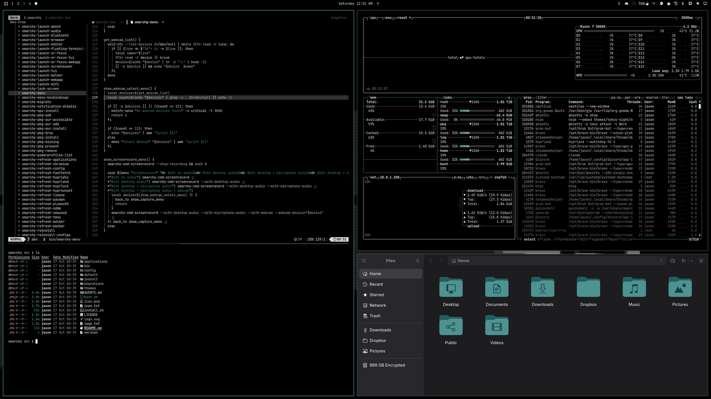
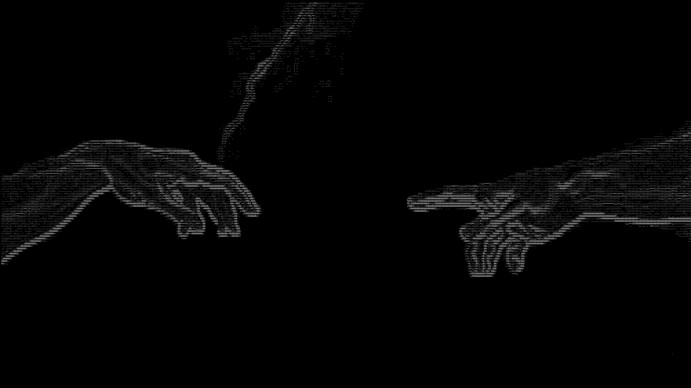
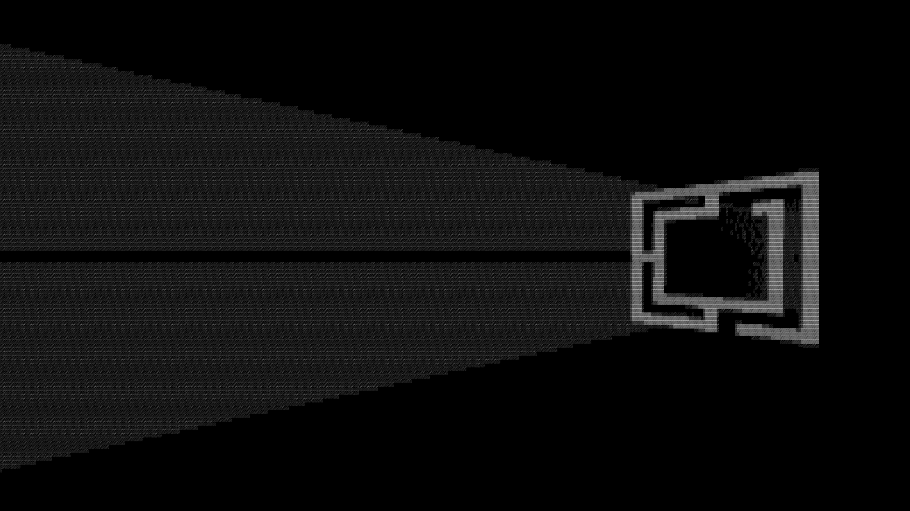

<p align="center">
  <picture>
    <source media="(prefers-color-scheme: dark)" srcset=".github/wordmark-dark.png">
    
  </picture>
</p>

## About

A pure-black theme for [Omarchy](https://omarchy.org), DHH's opinionated Linux distro. White text and a touch of green on the inky blacks your OLED monitor craves.

## Preview



## Wallpapers

All wallpapers are pure black (#000000) as a base and have white/grayscale ASCII art on top of that. The default wallpaper is pure black.

The shortcut for switching wallpapers is <kbd>Ctrl</kbd>+<kbd>Super</kbd>+<kbd>Space</kbd>

<table>
  <tr>
    <td>OLED Black</td>
    <td>Hand of Adam</td>
    <td>Omarchy Window</td>
  </tr>
  <tr>
    <td></td>
    <td></td>
    <td></td>
  </tr>
</table>

## Installation

The following command needs to be run to install 

```bash
omarchy-theme-install https://github.com/JaxonWright/omarchy-midnight-theme.git
```

## Usage

Once installed, press <kbd>Ctrl</kbd>+<kbd>Shift</kbd>+<kbd>Super</kbd>+<kbd>Space</kbd>, select "Midnight" and everything should refresh automatically
